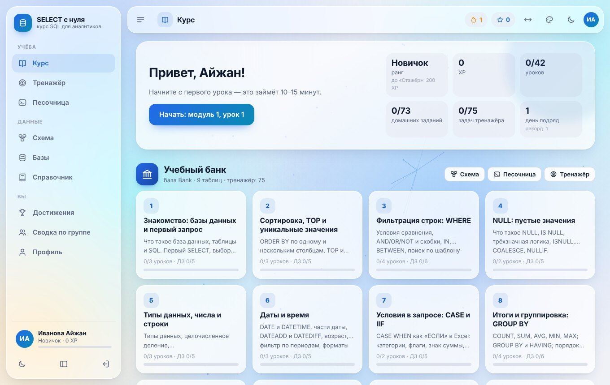
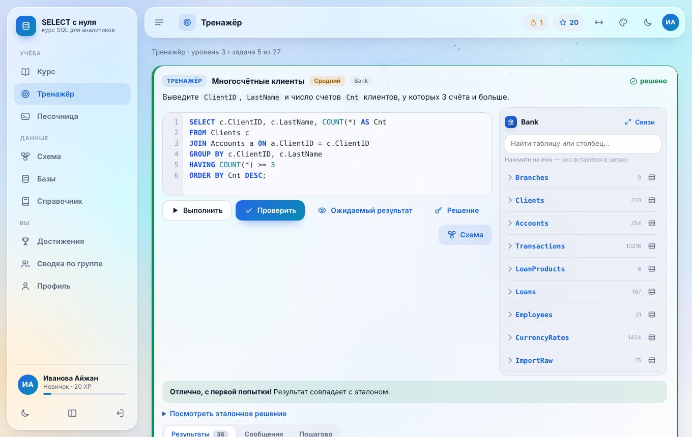
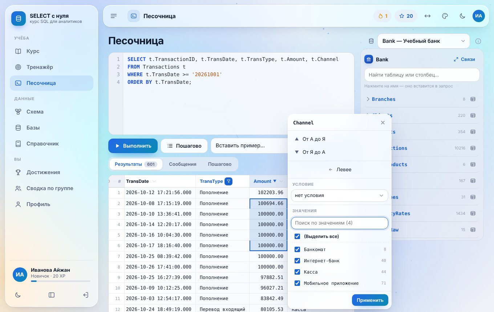
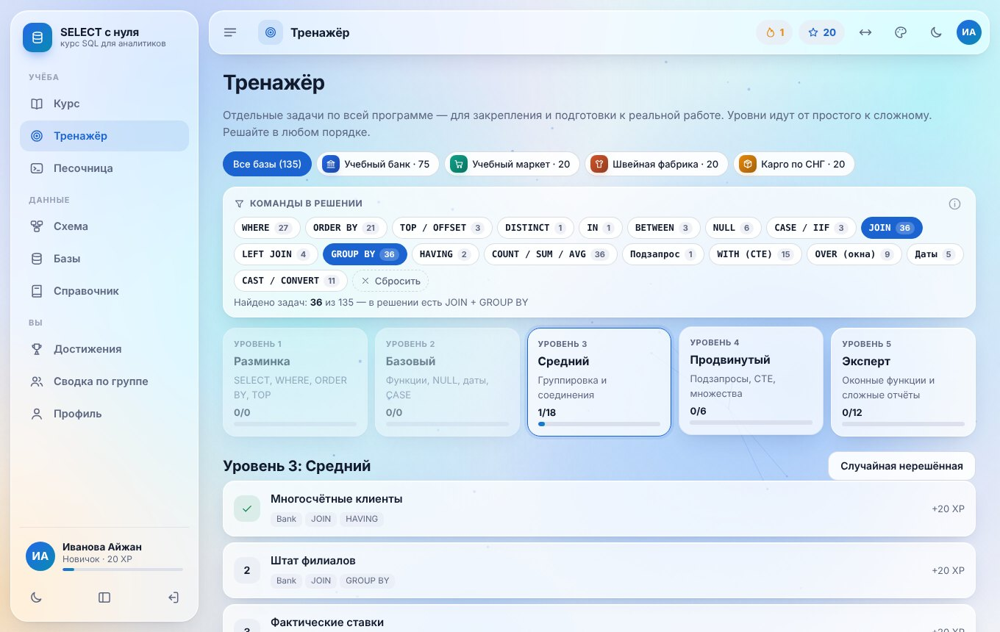
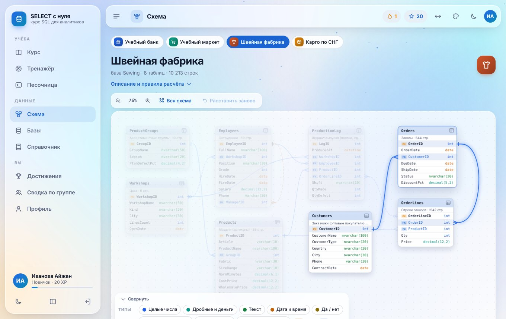
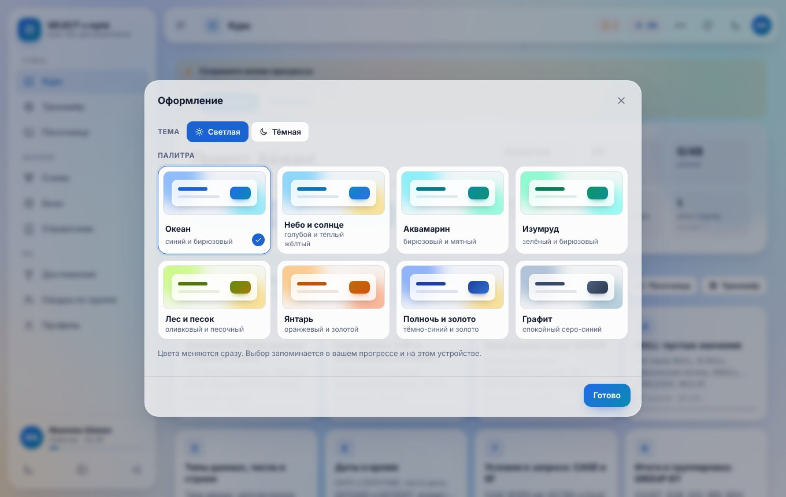
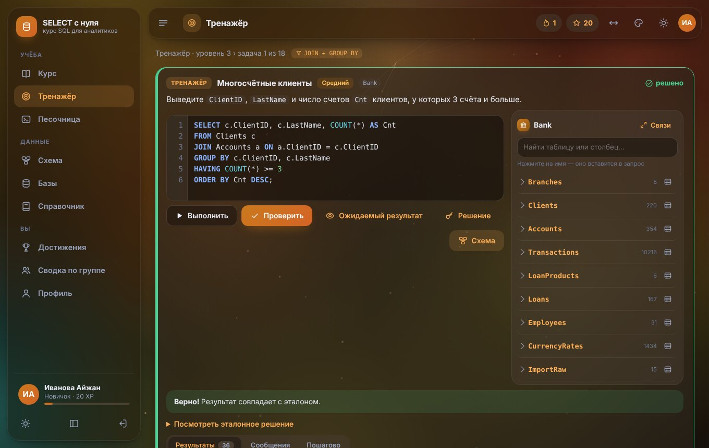
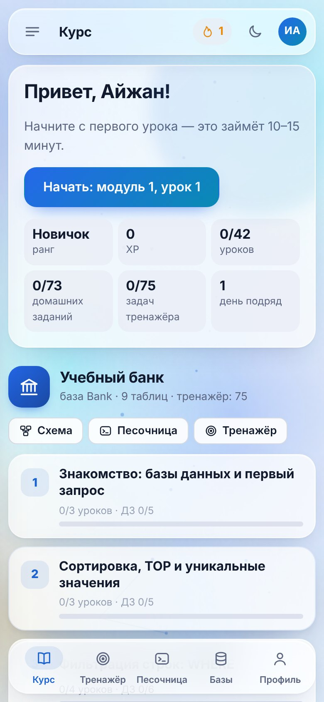
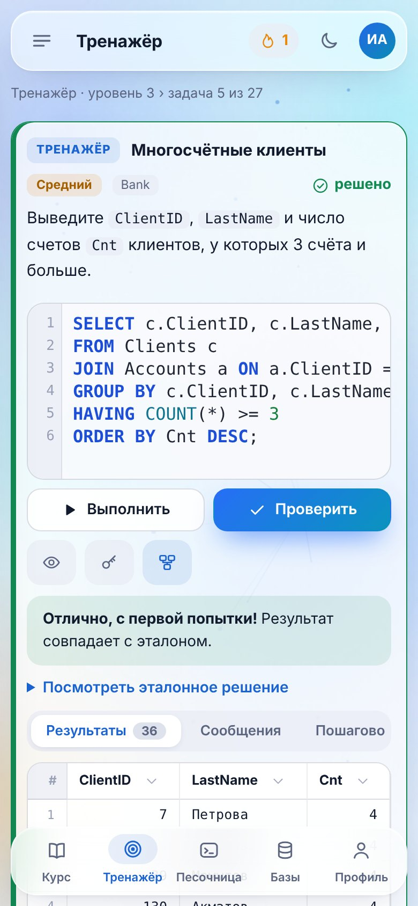
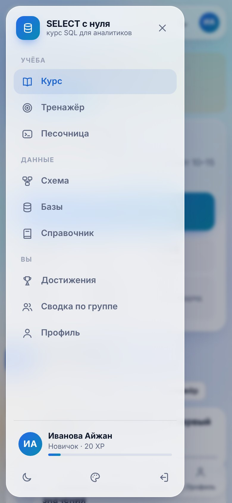

# SELECT с нуля — курс T-SQL для аналитиков

Интерактивный курс по чтению данных в Microsoft SQL Server: **только SELECT**, от первого запроса до оконных функций. Всё работает прямо в браузере — без сервера, без установки и без SQL Server. Запросы выполняет встроенный учебный движок T-SQL на учебных базах.

**▶ Открыть курс онлайн: https://kutya001.github.io/SQL-Study/**

Курс бесплатный и открытый: код — под [AGPL-3.0](LICENSE), учебные материалы — под [CC BY-SA 4.0](LICENSE-CONTENT). Учитесь, делитесь, дорабатывайте — только сохраняйте авторство и ту же лицензию.



## Что внутри

- **14 модулей, 42 урока**: теория малыми шагами, интерактивные схемы, примеры, которые можно запускать и менять.
- **Мини-тренировка** после каждого урока и **домашнее задание** после модуля (73 задачи).
- **Тренажёр**: 75 задач на 5 уровнях — от разминки до оконных функций.
- **Проверка по результату**: курс сравнивает ваш результат с эталоном и объясняет, что не так (не те столбцы, лишние строки, сортировка, типы).
- **Тренажёр** отбирает задачи по командам из решения: `WHERE`, `JOIN`, `GROUP BY`, оконные функции и т. д.
- **Песочница** — свободные запросы к любой учебной базе, в том числе к нескольким сразу (`USE`, `База.dbo.Таблица`).
- **Таблицы как в Excel**: фильтр и сортировка по столбцу, выделение диапазона с суммой и средним, копирование в Excel, перенос и ширина столбцов.
- **Схема базы** рядом с редактором: таблицы, столбцы, связи, данные. Щелчок по имени вставляет его в запрос.
- **Схема связей на холсте**: таблицы можно двигать, масштабировать; подсвечиваются прямые связи таблицы, виды связей и типы столбцов.
- **Справочник** — шпаргалка по всем темам, каждый пример запускается.
- Учётные записи, опыт (XP), ранги, достижения, серия дней, сводка по группе с выгрузкой в Excel.

| Решение задачи со схемой базы | Песочница: фильтр по столбцу и выделенный диапазон |
|---|---|
|  |  |

| Тренажёр: отбор задач по командам | Схема базы: связи выбранной таблицы |
|---|---|
|  |  |

**Оформление на выбор:** светлая и тёмная тема и восемь палитр — «Океан», «Небо и солнце», «Аквамарин», «Изумруд», «Лес и песок», «Янтарь», «Полночь и золото», «Графит». Переключаются кнопкой с палитрой вверху (на телефоне — в меню) или в профиле; выбор запоминается.

|  |  |
|---|---|

Курс можно растянуть на всю ширину монитора (кнопка ↔ вверху). Фон за карточками живой: плавно движется, отзывается на прокрутку и курсор; на слабом компьютере его можно выключить в профиле.

**На телефоне** курс работает полноценно: нижняя панель разделов, меню слева, схема базы в шторке снизу, крупные кнопки «Выполнить» и «Проверить». Светлая и тёмная тема, панели с эффектом матового стекла.

| Главная | Задача | Меню |
|---|---|---|
|  |  |  |

Программа: 1 Знакомство · 2 Сортировка, TOP, DISTINCT · 3 Фильтры WHERE · 4 NULL · 5 Типы, числа, строки · 6 Даты · 7 CASE и IIF · 8 Группировка · 9 JOIN · 10 Подзапросы и APPLY · 11 UNION, INTERSECT, EXCEPT · 12 CTE, рекурсия, временные таблицы · 13 Оконные функции · 14 Итоги (ROLLUP/CUBE), быстрые запросы и итоговый проект.

## Учебные базы

| База | Что это | Таблиц | Строк | Задания |
|---|---|---|---|---|
| 🏦 **Bank** — Учебный банк (встроенная) | клиенты, счета, операции, кредиты, филиалы, курсы валют | 9 | ~12 000 | весь основной курс |
| 🛒 **Shop** — Учебный маркет | розничная сеть: магазины, товары, чеки, поставки | 8 | 10 599 | мини-курс, практикум 29, тренажёр 20 |
| 🧵 **Sewing** — Швейная фабрика | 10 ассортиментных групп, цеха, заказы, выпуск и брак | 8 | 10 213 | мини-курс, практикум 29, тренажёр 20 |
| 📦 **Cargo** — Карго по СНГ | склады, рейсы, посылки, тарифы, претензии | 7 | 7 857 | мини-курс, практикум 29, тренажёр 20 |

Данные выдуманные, но правдоподобные: сомы, города Кыргызстана и СНГ, NULL-ы, отмены, «ловушки» для JOIN и дат. Каждый ученик сам выбирает, какие базы изучать (страница «Базы»).

Новые базы добавляются **без правки кода** — папкой в `schemas/`. Формат: [schemas/ФОРМАТ.md](schemas/ФОРМАТ.md). Готовая инструкция для ИИ, который сгенерирует базу с заданиями: [skills/sql-kurs-uchebnaya-baza](skills/sql-kurs-uchebnaya-baza/SKILL.md).

## Как начать

**Онлайн.** Откройте https://kutya001.github.io/SQL-Study/ в браузере компьютера или телефона, выберите «Хранить в браузере», создайте учётную запись — и начинайте с модуля 1.

**Без интернета.** Нажмите на GitHub *Code → Download ZIP*, распакуйте архив в обычную папку и откройте `index.html`. Курс работает прямо из папки (`file://`).

### Где хранится прогресс

- **В браузере** (рекомендуется) — сохраняется сам после каждого действия и остаётся после закрытия браузера. Две копии (localStorage + IndexedDB), история снимков с откатом, защита от двух открытых вкладок, копия в файл одной кнопкой и «Автокопия» раз в день. Работает даже там, где политика организации запрещает браузеру доступ к файлам.
- **В папке** — файлы `progress/<логин>.json` (Chrome/Edge). Удобно, если папка лежит на общем диске и преподаватель смотрит сводку по группе.

Прогресс привязан к браузеру: Chrome и Edge хранят данные отдельно. Перенос на другой компьютер — «Скачать копию» в профиле и «Восстановить из файла» на стартовой странице. Подробно, включая что делать, если браузер очищает данные при закрытии: [ИНСТРУКЦИЯ.txt](ИНСТРУКЦИЯ.txt), разделы 2 и 6.

## Документация

| Документ | Для кого |
|---|---|
| [ИНСТРУКЦИЯ.txt](ИНСТРУКЦИЯ.txt) | ученикам и преподавателям: запуск, прогресс, сводка по группе, частые проблемы |
| [schemas/ФОРМАТ.md](schemas/ФОРМАТ.md) | авторам учебных баз: формат папки, CSV, задания, проверка |
| [docs/КОНТЕНТ.md](docs/КОНТЕНТ.md) | авторам уроков: модули, шаги уроков, задачи, тренажёр, справочник |
| [docs/АРХИТЕКТУРА.md](docs/АРХИТЕКТУРА.md) | разработчикам: как устроены движок, проверка, хранилище, страницы |
| [docs/РАЗРАБОТКА.md](docs/РАЗРАБОТКА.md) | разработчикам: запуск, инструменты, проверки, публикация |

## Скиллы для ИИ-помощников

В папке [`skills/`](skills/) — готовые инструкции (формат Agent Skills: `SKILL.md`) для Claude и других ИИ-ассистентов. С ними ИИ делает работу по правилам проекта и сам проверяет результат движком курса:

| Скилл | Что делает |
|---|---|
| [sql-kurs-uchebnaya-baza](skills/sql-kurs-uchebnaya-baza/SKILL.md) | генерирует новую учебную базу: схема, данные, практикум, тренажёр, примеры, мини-курс |
| [sql-kurs-uroki](skills/sql-kurs-uroki/SKILL.md) | пишет новые уроки, задачи, домашние задания и задачи тренажёра для основного курса |
| [sql-kurs-razrabotka](skills/sql-kurs-razrabotka/SKILL.md) | дорабатывает само приложение: движок T-SQL, страницы, хранилище — с проверками и публикацией |

Как подключить: в Claude — загрузите папку скилла (или zip с ней) в настройках скиллов; в Claude Code — скопируйте папку в `.claude/skills/`. Можно и просто дать ИИ ссылку на `SKILL.md`.

## Для разработчиков

Курс — обычные HTML, CSS и JavaScript без сборки и зависимостей. Для инструментов нужен только Node.js.

```
index.html            точка входа
css/app.css           оформление (светлая и тёмная тема, восемь палитр)
js/engine/            учебный движок T-SQL, встроенная база Bank, формат учебных баз
js/app/               приложение: страницы, редактор, проверка, хранилище, реестр баз
content/              курс: настройки, модули с уроками, тренажёр, справочник
schemas/              учебные базы (папка на базу) + index.js — их сборка одним файлом
tools/                проверки, сборка index.js, запросы из консоли, генераторы данных
skills/               скиллы для ИИ
docs/                 документация
progress/             папка для файлов прогресса в режиме «в папке» (в git не попадают)
```

```bash
node tools/validate-course.js      # все уроки, ДЗ, тренажёр и справочник: эталоны выполняются
node tools/validate-packs.js       # все учебные базы: данные, связи, задания
node tools/test-engine.js          # движок T-SQL: запросы с известным результатом
node tools/build-index.js          # пересобрать schemas/index.js после правки баз
node tools/sql.js sewing "SELECT TOP 5 * FROM Orders"   # запрос к учебной базе из консоли
python3 -m http.server 8000        # открыть курс на http://localhost:8000
```

При каждом push в `main` GitHub Actions проверяет курс и все базы, пересобирает `schemas/index.js` и публикует сайт ([.github/workflows/pages.yml](.github/workflows/pages.yml)). Подробно — [docs/РАЗРАБОТКА.md](docs/РАЗРАБОТКА.md).

Хотите добавить базу, урок или исправить ошибку — делайте форк и присылайте pull request. Проверки должны проходить без ошибок, а `id` уже выпущенных задач менять нельзя: к ним привязан прогресс учеников.

## Источники

Курс написан заново; разделы «Почитать» в модулях ведут на руководство по SQL Server на [metanit.com](https://metanit.com/sql/sqlserver/). Учебный движок поддерживает подмножество T-SQL для чтения данных — чем он отличается от настоящего SQL Server, сказано в [ИНСТРУКЦИЯ.txt](ИНСТРУКЦИЯ.txt), раздел 5.

## Лицензия

© 2026 Омуралиев Кутман ([kutya001](https://github.com/kutya001)).

- **Код** (`index.html`, `css/`, `js/`, `tools/`, `.github/`) — [GNU AGPL-3.0](LICENSE). Любую изменённую версию, в том числе размещённую на сайте, нужно распространять под этой же лицензией с исходным кодом.
- **Учебные материалы** (`content/`, `schemas/`, документация, `skills/`) — [CC BY-SA 4.0](LICENSE-CONTENT). Можно копировать, переводить и переделывать для любых целей с указанием автора и под той же лицензией.
